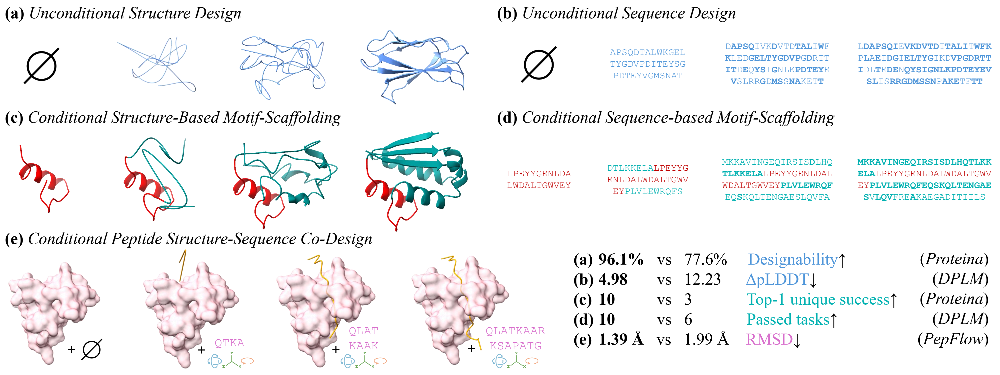

# GPFlow: Generalized Poisson Flow

Code by Chaoran Cheng & [Zhanghan Ni](https://github.com/ZhanghanNi). Last updated: Nov 24, 2026.

𝐕𝐚𝐫𝐢𝐚𝐛𝐥𝐞-𝐋𝐞𝐧𝐠𝐭𝐡 𝐆𝐞𝐧𝐞𝐫𝐚𝐭𝐢𝐯𝐞 𝐏𝐫𝐨𝐭𝐞𝐢𝐧 𝐃𝐞𝐬𝐢𝐠𝐧 𝐯𝐢𝐚 𝐆𝐞𝐧𝐞𝐫𝐚𝐥𝐢𝐳𝐞𝐝 𝐏𝐨𝐢𝐬𝐬𝐨𝐧 𝐅𝐥𝐨𝐰, 𝐶ℎ𝑎𝑜𝑟𝑎𝑛 𝐶ℎ𝑒𝑛𝑔*, 𝑍ℎ𝑎𝑛𝑔ℎ𝑎𝑛 𝑁𝑖*, 𝑌𝑎𝑛𝑟𝑢 𝑄𝑢*, 𝑌𝑢𝑥𝑖𝑛 𝐶ℎ𝑒𝑛, 𝑅𝑢𝑖ℎ𝑎𝑛 𝐺𝑢𝑜, 𝐽𝑖𝑎𝑗𝑢𝑛 𝐹𝑎𝑛, and 𝐺𝑒 𝐿𝑖𝑢, 𝑵𝒆𝒖𝒓𝑰𝑷𝑺 𝟐𝟎𝟐𝟔, [arXiv](https://arxiv.org/abs/2607.09039).

<p align="center">
  
</p>

GPFlow is a framework for variable-length generative modeling of biological sequences and structures. We have applied GPFlow across different design tasks including (a) 𝒖𝒏𝒄𝒐𝒏𝒅𝒊𝒕𝒊𝒐𝒏𝒂𝒍 𝒔𝒕𝒓𝒖𝒄𝒕𝒖𝒓𝒆 𝒅𝒆𝒔𝒊𝒈𝒏, (b) 𝒖𝒏𝒄𝒐𝒏𝒅𝒊𝒕𝒊𝒐𝒏𝒂𝒍 𝒔𝒆𝒒𝒖𝒆𝒏𝒄𝒆 𝒅𝒆𝒔𝒊𝒈𝒏, (c) 𝒔𝒕𝒓𝒖𝒄𝒕𝒖𝒓𝒆-𝒃𝒂𝒔𝒆𝒅 𝒎𝒐𝒕𝒊𝒇-𝒔𝒄𝒂𝒇𝒇𝒐𝒍𝒅𝒊𝒏𝒈, (d) 𝒔𝒆𝒒𝒖𝒆𝒏𝒄𝒆-𝒃𝒂𝒔𝒆𝒅 𝒎𝒐𝒕𝒊𝒇-𝒔𝒄𝒂𝒇𝒇𝒐𝒍𝒅𝒊𝒏𝒈, and (e) 𝒑𝒆𝒑𝒕𝒊𝒅𝒆 𝒄𝒐-𝒅𝒆𝒔𝒊𝒈𝒏. These tasks cover variable-length continuous, discrete, and Riemannian modalities, as well as their combinations. Compared to fixed-length baselines, GPFlow consistently improves performance.

This repository organizes its implementations by model base and data modality. Currently, the structure design code and checkpoints are ready, with sequence design and peptide co-design in preparation.


## Repository organization

```text
generalized-poisson-flow/
├── assets/
├── structure_design/   # GPFlow adapted to Proteina and protein structure data
├── sequence_design/    # Sequence DiT and UniRef50; implementation forthcoming
├── peptide_codesign/   # PepFlow and peptide data; implementation forthcoming
├── README.md
└── LICENSE
```

| Directory | Model base | Data | Status |
| --- | --- | --- | --- |
| [structure_design](structure_design/) | Proteina | Protein structures (PDB & AFDB) | Available |
| [sequence_design](sequence_design/) | Sequence DiT | UniRef50 | Preparing |
| [peptide_codesign](peptide_codesign/) | PepFlow | Peptide data | Preparing |


## Structure design

The structure-design implementation adapts Proteina for variable-length protein backbone generation. It combines continuous flow matching of Cα coordinates with learned residue insertions and supports unconditional generation and motif scaffolding with coordinate inpainting. Start with its [README](structure_design/README.md) for environment installation, datasets, checkpoints, training, generation, and evaluation.

## License and attribution

The root-level GPFlow documentation and repository scaffolding are provided under the [MIT License](LICENSE). Each model subdirectory may have its own license, and bundled third-party components retain their applicable licenses and attribution notices. The root MIT license does not replace these licenses.

## Citation

If you use GPFlow in your research, please cite:

```bibtex
@inproceedings{cheng2026variablelength,
  title     = {Variable-Length Generative Protein Design via Generalized Poisson Flow},
  author    = {Chaoran Cheng and Zhanghan Ni and Yanru Qu and Yuxin Chen and
               Ruihan Guo and Jiajun Fan and Ge Liu},
  booktitle = {The Fortieth Annual Conference on Neural Information Processing Systems},
  year      = {2026},
  url       = {https://openreview.net/forum?id=znfwhqtvhg}
}
```
