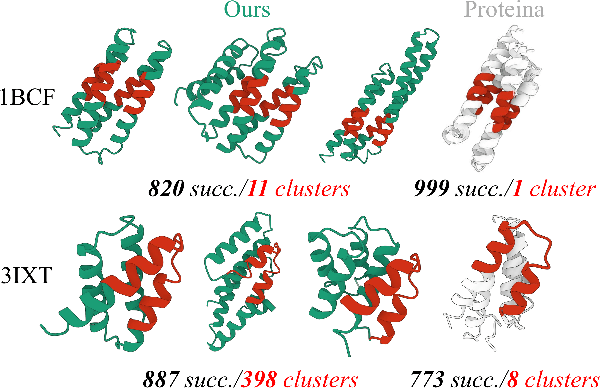

# GPFlow-Proteina for Structure-Based Protein Design

Code by Chaoran Cheng.

<p align="center">
  
</p>

This directory instantiates GPFlow for **protein structure design** by adapting [Proteina](https://github.com/NVIDIA-BioNeMo/proteina). The model evolves Cα coordinates and learns residue insertions during sampling, producing variable-length protein backbones. It supports two structure-design tasks:

- **Motif scaffolding:** grow scaffold segments around and between supplied motifs according to a contig, while preserving motif coordinates and the lengths of the motif segments through inpainting.
- **Unconditional backbone generation:** generate a protein backbone without specifying its final chain length.

Training uses protein structure data from PDB or AFDB. The sections below cover setup, training, generation, and task-specific evaluation.

## Installation

The locked environment targets Python 3.11, and PyTorch 2.4.1 with CUDA 12.4. With `uv` installed, run the commands in this README from `structure_design/` (`cd structure_design` from the repository root):

```bash
uv sync --locked --python 3.11
source .venv/bin/activate

export DATA_PATH="$PWD/data"
export HF_HOME="$PWD/.cache/huggingface"
export HF_HUB_CACHE="$HF_HOME/hub"
export CACHE_DIR="$HF_HUB_CACHE"
export PYTHON_EXEC="$PWD/.venv/bin/python"
mkdir -p "$DATA_PATH" "$HF_HUB_CACHE"
```

## Data and checkpoints

Released GPFlow checkpoints are hosted in the `structure_design/` subfolder of the [Google Drive checkpoint collection](https://drive.google.com/drive/folders/115f8O3nhhlNTIEWDSdR4Ebzg7UDmBJ9e?usp=sharing).

| Task | Checkpoint | Training |
| --- | --- | --- |
| Motif scaffolding | [motif_1M.ckpt](https://drive.google.com/file/d/1jb_cgAGol-0K87kaItJ9pHyecR3oJUvu/view) | AFDB, 1,000,000 iterations |
| Unconditional generation | [uncond_300k.ckpt](https://drive.google.com/file/d/1SvT9soTcT-B8ENA7cu4IsjWc8QYnC559/view) | PDB, 300,000 iterations |

Download the checkpoint for your task from Drive and save it with its original filename under `store/ckpts/structure_design/`. Create that directory from the model directory (`structure_design/`):

```bash
mkdir -p store/ckpts/structure_design
```

The shipped [motif](configs/experiment_config/inference_motif.yaml) and [unconditional](configs/experiment_config/inference_uncond.yaml) inference configs expect these paths relative to the current `structure_design/` working directory:

```text
store/ckpts/structure_design/
├── motif_1M.ckpt
└── uncond_300k.ckpt
```

Relative checkpoint paths resolve from the directory where the command is launched, so run these examples from `structure_design/`. Absolute paths, `~`, and environment variables are also supported. Override `ckpt_path` and `ckpt_name` on the command line to use a different checkpoint location.

The bundled motif inputs are under [motif_data/design25](motif_data/design25). They contain motif coordinates and contig annotations. Upstream reference assets and AFDB dataset indices are available in the Proteina [support files](https://catalog.ngc.nvidia.com/orgs/nvidia/teams/clara/resources/proteina_additional_files/files) and [training-data indices](https://catalog.ngc.nvidia.com/orgs/nvidia/teams/clara/resources/proteina_training_data_indices/files). When using these assets, extract them into this layout:

```text
$DATA_PATH/
├── pdb_raw/
│   └── cath_label_mapping.pt
├── metric_factory/
│   ├── features/
│   │   ├── D_FS_eval_ca_features.pth
│   │   ├── D_FS_afdb_cath_codes.pth
│   │   ├── pdb_eval_ca_features.pth
│   │   └── fold_class_mappings_C_selected_A_T_cath_codes.pth
│   └── model_weights/gearnet_ca.pth
├── d_FS/d_FS_index.txt
└── d_21M/
    ├── d_21M_index.txt
    ├── seq_d_21M.fasta
    ├── cluster_seqid_0.5_d_21M.fasta
    └── cluster_seqid_0.5_d_21M.tsv
```

Motif inference does not require downloading a training structure corpus. For training, prepare the chosen PDB/AFDB structures and configure the corresponding dataset YAML. The current `d_FS` configuration reads structures from `$DATA_PATH/afdb/`, independently of the index directory above.

## Motif scaffolding

Generate a small batch around the `1bcf` motif:

```bash
CUDA_VISIBLE_DEVICES=0 python proteinfoundation/motif_inference_gp.py \
  motif_task_name=1bcf \
  nsamples=16 \
  run_name=gpflow_demo/1bcf
```

The entry point uses [inference_motif.yaml](configs/experiment_config/inference_motif.yaml). Here `nsamples` is the total number of scaffolds, and `max_nsamples_per_batch` limits the batch size. The configuration defaults to 1,000 samples in batches of at most 16. Outputs are written to `inference/gpflow_demo/1bcf/`:

- Numbered scaffold PDB files, starting at `0.pdb`.
- `motif_info.csv`, containing the updated contig for each scaffold.

The entry point writes these outputs after all sampling batches finish. Use a distinct `run_name` for each run to keep its outputs separate. Motif generation and success evaluation always run as separate steps; see the [evaluation pipeline](#evaluation-pipeline).

For a custom motif, supply `motif_pdb_path` and a `contig_string`, or include the contig in the PDB's `REMARK 999 INPUT` annotations. Set `motif_only=true` for a PDB that contains only the selected motif residues, or `motif_only=false` when extracting them from a larger structure. A contig such as `0/A92-99/0/A123-130/0` contains two fixed motif segments and three linker locations. Numeric components mark where linkers can grow; they start empty. Numeric length ranges inherited from benchmark contigs do not constrain the generated linker lengths. The output `motif_info.csv` records the realized layout.

## Unconditional generation

The unconditional entry point starts from an empty chain and uses the same insertion process. Generate a small batch with the released `uncond_300k.ckpt` using the shipped configuration:

```bash
CUDA_VISIBLE_DEVICES=0 python proteinfoundation/inference_gp.py \
  --config_name inference_uncond \
  nsamples=16 nbatch=1 \
  compute_designability=false \
  run_name=gpflow_unconditional
```

For this entry point, `nsamples` is the number of samples **per batch** and `nbatch` is the number of batches. Outputs and generated lengths are saved under `inference/gpflow_unconditional/`, including `results_<rank>.csv`. The example disables the optional ProteinMPNN/ESMFold evaluation with `compute_designability=false`; set it to `true` to generate and evaluate in one run, as enabled by default in [inference_uncond.yaml](configs/experiment_config/inference_uncond.yaml). Both workflows are described in the [evaluation pipeline](#evaluation-pipeline).

## Sampling settings

Inference settings can be overridden on the command line using Hydra's `key=value` syntax.

| Setting | Default | Meaning |
| --- | --- | --- |
| `dt` | `0.0025` | 400 integration steps, calculated as `ceil(1 / dt)` |
| `seed` | `42` | Sampling seed |
| `self_cond` | `true` for motif, `false` for unconditional | Self-conditioning |
| `sampling_caflow.sampling_mode` | `sc` | Stochastic coordinate sampling; `vf` selects ODE sampling |
| `sampling_caflow.sc_scale_noise` | `0.35` | Stochastic noise scale |
| `sampling_caflow.scale_rate` | `0.6` for motif, `0.7` for unconditional | Multiplier for learned insertion rates |
| `sampling_caflow.tau_leap` | `false` for motif, `true` for unconditional | At most one insertion per gap and step; `true` samples Poisson counts |
| `schedule.schedule_mode`, `schedule.schedule_p` | `log`, `2.0` | Coordinate-time schedule |
| `schedule.schedule_edit_mode`, `schedule.schedule_edit_p` | `early_uniform`, `0.3` | Edit-time schedule |
| `max_length` | `384` | Threshold for stopping further insertions |
| `guidance_weight` | `1.0` | Autoguidance is disabled |

Output length is determined by the insertion process. `max_length` is a stopping threshold: simultaneous insertions can exceed it. Fixed-length generation is not supported.

## Training

Motif training uses [training_ca_motif.yaml](configs/experiment_config/training_ca_motif.yaml), [caflow_motif.yaml](configs/experiment_config/model/caflow_motif.yaml), and the dataset configuration selected by `dataset` and `dataset_config_subdir`. The current motif configuration selects [d_FS.yaml](configs/datasets_config/afdb/d_FS.yaml).

Prepare the structure data and check the dataset paths and batch size before starting training. A single-GPU invocation is:

```bash
CUDA_VISIBLE_DEVICES=0 python proteinfoundation/train.py \
  --config_name training_ca_motif \
  --single \
  opt.dist_strategy=auto \
  run_name=gpflow_motif \
  log.log_wandb=false
```

`--single` selects one GPU and appends `_single` to the run name. Checkpoints and saved configurations are written under `store/<run_name>/`. For two GPUs, omit `--single`, expose two devices with `CUDA_VISIBLE_DEVICES=0,1`, and set `hardware.ngpus_per_node=2 hardware.nnodes=1 opt.dist_strategy=ddp`. `--nolog` disables logging and automatic checkpoints; `--no_prog_bar` hides the progress bar.

Training automatically resumes from the latest `last.ckpt` or `last-vN.ckpt` in the run's checkpoint directory when one exists. To resume from a particular checkpoint, set `resume_ckpt_path` in the training YAML or on the command line; relative paths use the same launch-directory rule as inference:

```bash
python proteinfoundation/train.py --config_name training_ca \
  resume_ckpt_path=store/train_pdb/checkpoints/last.ckpt
```

An explicit `resume_ckpt_path` takes precedence over automatic discovery and restores model weights, optimizer state, EMA state, and training progress; it does not require `--resume`. Keep the matching `-EMA.ckpt` companion beside regular GPFlow EMA checkpoints. The optional `--resume` flag requires either an explicit resume checkpoint or a last checkpoint in the current run directory instead of starting a new run when none exists. `pretrain_ckpt_path=store/previous_run/checkpoints/model.ckpt` initializes model weights only, and is used only when no resume checkpoint is selected. Use a fresh run name for weights-only fine-tuning.

### Prepare the AFDB training corpus

For our AFDB experiments, we used a complete local copy of the approximately **21-million-entry AFDB training corpus (`D_21M`)** and reclustered its entries following the clustering procedure described in [Proteina, Appendix M.2](https://arxiv.org/html/2503.00710v1#A13.SS2). At the time, AFDB v4 had been retired from the live download service, and the originally shipped download script could no longer retrieve the indexed structures.

For new datasets, we recommend using the latest AFDB release (**v6**) and rerunning the filtering and clustering procedure whenever possible, generating indices for that release. The shipped v4 indices should not be treated as an interchangeable index of v6.

We have now patched `script_utils/download_afdb_data.sh` to recover **v4** structures from the [Steinegger Foldcomp mirror](https://opendata.mmseqs.org/foldcomp/). The command below prepares the shipped v4 subset:

```bash
uv sync --inexact
bash script_utils/download_afdb_data.sh \
  "$DATA_PATH/d_FS/d_FS_index.txt" "$DATA_PATH/afdb"
```

The script writes `raw/AF-<accession>-F1-model_v4.pdb` under the output directory. Foldcomp reconstructs coordinates using lossy compression; these are not byte-identical copies of the original PDB/mmCIF files.

### Prepare the PDB training corpus

[pdb_train.yaml](configs/datasets_config/pdb/pdb_train.yaml) uses `fraction: 1.0`, retaining all entries that pass its selector: protein sequences with **50 < SEQRES length < 256**, one chain per PDB entry according to the SEQRES chain count, diffraction or EM structures, and resolution ≤ 5 Å. It also excludes non-standard sequences and unavailable structures. The monomer filter uses that metadata chain count, not a biological-assembly analysis.

Install MMseqs2 separately and make its `mmseqs` executable available on `PATH`; `uv sync` does not install this binary. With `DATA_PATH` exported as above, prepare the corpus from `structure_design/`:

```bash
mmseqs version
python -c '
import hydra
import lightning as L
from omegaconf import OmegaConf

L.seed_everything(42)
cfg = OmegaConf.load("configs/datasets_config/pdb/pdb_train.yaml")
datamodule = hydra.utils.instantiate(cfg.datamodule)
datamodule.prepare_data()  # Download metadata/mmCIF files and process selected chains.
datamodule.setup("fit")   # Cluster sequences and create the train/validation splits.
'
```

Data are stored under `$DATA_PATH/pdb_train/`, with downloaded structures in `raw/`, processed tensors in `processed/`, and selection/clustering metadata alongside them. `setup("fit")` runs MMseqs2 at 50% sequence identity with coverage `0.8` (`--cov-mode 1`), then assigns whole clusters to train/validation/test with requested fractions `0.98/0.019/0.001`. Training uses `cluster-random` sampling.

### Training Setup

Training stops at `opt.max_steps` with a `opt.max_epochs=-1`. Validation-time generation uses `validation.nsamples`, defaulting to **16 samples total across all training GPUs**, independently of the inference config's `nsamples`. Generation and ProteinMPNN/ESMFold evaluation are sharded across DDP ranks. The `sample/*` metrics report means over all generated samples, weighted by each rank's sample count. Pass `validation.nsamples=32` to change the total, or `validation.nsamples=0` to skip generation and evaluation while retaining validation losses. Each validation step retains its outputs under `store/<run>/step<global_step>_samples/` (for example, `step5000_samples/`), with generated `{sample_idx}.pdb` files and separate `{sample_idx}/` evaluation artifacts. Motif training use the same unconditional validation generation check.

## Evaluation pipeline

Unconditional generation supports designability evaluation during generation or as a later step. Motif scaffolding always separates generation from success evaluation. After either evaluation, use the corresponding diversity mode to cluster designable or successful backbones. Novelty is currently configured for unconditional generation; secondary-structure (SS) analysis applies to both tasks.

Designability and motif-success evaluation use ProteinMPNN to design sequences and ESMFold to refold them. Install their weights with:

```bash
bash script_utils/download_pmpnn_weghts.sh
```

The script downloads the ProteinMPNN weights and the `facebook/esmfold_v1` checkpoint into the configured Hugging Face cache. These assets are separate from the GPFlow generation checkpoint. All calculation scripts take explicit sample directories. The `inference/...` paths below refer to the generation examples above; replace them with your own output directories.

### Unconditional designability

For generation and designability in one run, use the [unconditional generation command](#unconditional-generation) with `compute_designability=true`. Each generated backbone is evaluated before the run finishes; no separate designability command is needed.

To decouple the two steps, generate with `compute_designability=false`, as in the example above, then run:

```bash
CUDA_VISIBLE_DEVICES=0 python script_utils/cal_designability.py \
  inference/gpflow_unconditional --config_name inference_uncond
```

The standalone evaluator reads `<samples_dir>/b{batch_idx}_i{idx}/b{batch_idx}_i{idx}.pdb`. Both routes use `designability_seqs_per_struct` from the selected inference config (default: eight) and classify a backbone as designable when at least one designed sequence has Cα self-consistency RMSD ≤ 2 Å. Results are written to `results_<rank>.csv`, with refolding artifacts beside each generated PDB. The standalone evaluator replaces the corresponding generation-only CSV with its evaluation results.

### Motif-scaffolding success

First generate scaffolds with [motif_inference_gp.py](proteinfoundation/motif_inference_gp.py), then run [cal_motif_success.py](script_utils/cal_motif_success.py). This evaluation is always separate from motif generation and designs eight sequences per scaffold. **Supplied motif amino acids are always fixed** via ProteinMPNN's input argument for biologically meaningful design. Unknown amino-acid positions remain designable.

Evaluate the 16-sample example above with:

```bash
CUDA_VISIBLE_DEVICES=0 python script_utils/cal_motif_success.py \
  inference/gpflow_demo 1bcf \
  --n_sample 16
```

The evaluator expects `<samples_dir>/<task>/0.pdb`, subsequent numbered PDBs, and `motif_info.csv`. It reads the reference motif from `motif_data/design25/<task>.pdb` by default; use `--motif_dir /path/to/motifs` to supply another reference directory. The sample count must match the number of contigs.

A scaffold succeeds when **one sequence satisfies all four criteria**:

| Metric | Threshold |
| --- | --- |
| Cα self-consistency RMSD | ≤ 2 Å |
| Motif backbone RMSD | ≤ 1 Å |
| pAE | ≤ 5 Å |
| pLDDT | ≥ 70 on the 0–100 scale |

Independent best values across different sequences do not establish success. The CSV's aggregate metric columns can come from different sequences; use its `success` field and per-sequence values. The evaluation script logs execution failures and returns sentinel metrics for them, so check for errors before interpreting a run's success rate.

### Diversity: unconditional and motif modes

After designability or motif-success evaluation, cluster the selected original backbones with [cal_diversity.py](script_utils/cal_diversity.py) and a separate Foldseek installation:

```bash
export FOLDSEEK_PATH=/absolute/path/to/foldseek

# Unconditional: cluster backbones with scRMSD <= 2 Angstrom.
python script_utils/cal_diversity.py inference/gpflow_unconditional \
  --mode unconditional --recopy

# Motif scaffolding: cluster scaffolds whose success field is true.
python script_utils/cal_diversity.py inference/gpflow_demo \
  --mode motif --tasks 1bcf --recopy
```

Unconditional mode reads `<samples_dir>/results_*.csv` and uses a TM-score threshold of `0.5`. Motif mode reads `<samples_dir>/<task>/results_*.csv` and uses `0.6`; omit `--tasks` to evaluate all task directories containing results. Both use `easy-cluster` with `--alignment-type 1 --cov-mode 0 --min-seq-id 0`. No reference database is required. `--recopy` refreshes the selected PDBs before clustering.

Each run or task receives `res_cluster.tsv` and `res_rep_seq.fasta`. Unconditional mode reports the cluster count and its ratio to designable backbones; motif mode writes per-target unique-success counts to `<samples_dir>/clusters.json`. Unique successes are counted separately within each motif target. For verified counts, check cluster membership against the selected backbone IDs and count FASTA headers; a failed Foldseek subprocess raises an error.

### Novelty: unconditional generation

The current evaluation pipeline configures novelty for unconditional generation. Supply a prepared Foldseek reference database explicitly:

```bash
python script_utils/cal_novelty.py inference/gpflow_unconditional \
  --db_path /absolute/path/to/foldseek_database/pdb --db pdb
```

`--db_path` is the database prefix, not its containing directory; `--db` labels the output files. The script searches all generated backbones and writes `out_pdb.tsv` and `log_novelty_pdb.txt` in the sample directory. It reports the mean best-hit TM-score against the reference database; lower values indicate greater novelty. Use `FOLDSEEK_PATH` or `--foldseek_path` to select the executable.

### Secondary structure: both tasks

Run [cal_secondary.py](script_utils/cal_secondary.py) on an unconditional run directory or one motif-target directory:

```bash
python script_utils/cal_secondary.py inference/gpflow_unconditional
python script_utils/cal_secondary.py inference/gpflow_demo/1bcf
```

The script averages alpha-helix, beta-sheet, and coil fractions over the original generated structures and saves `ss_stats.json` in the supplied directory. Neither designability nor motif-success evaluation is required. Refolding artifacts are excluded from the default input selection.

## Code map

| File | Purpose |
| --- | --- |
| [proteina_gp.py](proteinfoundation/proteinflow/proteina_gp.py) | Training losses, model wrapper, and generation interface |
| [r3n_fm.py](proteinfoundation/flow_matching/r3n_fm.py) | Coordinate integration, residue insertions, and motif inpainting |
| [protein_transformer.py](proteinfoundation/nn/protein_transformer.py) | Coordinate and insertion predictions |
| [motif_factory.py](proteinfoundation/nn/motif_factory.py) | Motif conditioning and contig handling |
| [train.py](proteinfoundation/train.py) | Training entry point |
| [motif_inference_gp.py](proteinfoundation/motif_inference_gp.py) | Variable-length motif scaffolding |
| [inference_gp.py](proteinfoundation/inference_gp.py) | Unconditional variable-length generation |

## Attribution and license

GPFlow builds on NVIDIA's [Proteina](https://github.com/NVIDIA-BioNeMo/proteina) implementation. The repository retains the [NVIDIA License](PROTEINA_LICENSE), including its restriction to non-commercial research or evaluation use. Bundled components also include their own license files.

GPFlow additions and modifications are copyright © 2026 Chaoran Cheng. The [GPFlow contribution terms](LICENSE) grant MIT permissions for those contributions, subject to the NVIDIA License's required non-commercial research/evaluation restriction for Proteina-derived work. Both license files apply to the GPFlow adaptation; the root MIT license does not replace the NVIDIA License.
